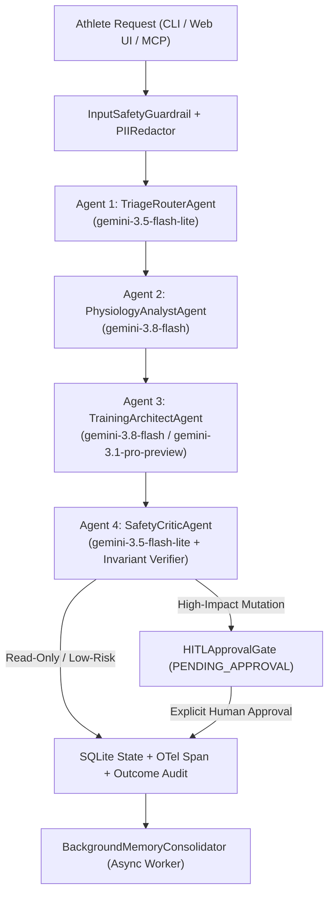

# Multi-Agent Topology, Model Routing & Governance (`AGENTS.md`)

> **Repository:** `JackieAgent` — Oura-Native Adaptive Half-Marathon Coach  
> **Architecture Level:** L200 Production Multi-Agent System

---

## 1. Supervisor Multi-Agent Topology

`JackieAgent` coordinates four specialized sub-agents under [`MultiAgentCoachOrchestrator`](oura_connect/orchestrator.py), flanked by deterministic **Input/Output Safety Guardrails**, **Human-in-the-Loop (HITL) Approval Gates**, **LLM Conversation History Compaction**, and **Asynchronous Background Memory Consolidation**:

---

## 2. Dynamic Gemini 3 Model Routing Matrix

[`ModelRouter`](oura_connect/orchestrator.py) dynamically assigns each sub-task to the most cost- and latency-appropriate current Gemini 3 model via the `google-genai` Interactions API (`client.interactions.create`), with automatic multi-tier fallback chains:

| Sub-Agent / Task | Primary Model | Fallback Chain | Rationale |
| :--- | :--- | :--- | :--- |
| **`TriageRouterAgent`** | `gemini-3.5-flash-lite` | `gemini-3.8-flash` | Sub-second intent classification & complexity scoring (`0.0–1.0`). |
| **`ConversationMemoryManager`** | `gemini-3.5-flash-lite` | `gemini-3.8-flash` | High-throughput token-budgeted conversation history compaction. |
| **`PhysiologyAnalystAgent`** | `gemini-3.8-flash` | `gemini-3.5-flash-lite` | Fast multimodal/tool synthesis over 28-day rolling Oura HRV/RHR/Sleep metrics. |
| **`TrainingArchitectAgent` (Standard)** | `gemini-3.8-flash` | `gemini-3.1-pro-preview` &rarr; `gemini-3.5-flash-lite` | Daily workout guidance and single-slot swaps. |
| **`TrainingArchitectAgent` (Complex / Injury)** | `gemini-3.1-pro-preview` | `gemini-3.8-flash` &rarr; `gemini-3.5-flash-lite` | Deep periodization reasoning (`complexity >= 0.75`, injury reports, multi-week replans). |
| **`SafetyCriticAgent`** | `gemini-3.5-flash-lite` | `gemini-3.8-flash` | Fast post-generation invariant audit paired with deterministic exercise-physiology rules. |

---

## 3. Agentic Guardrails & Human-in-the-Loop (HITL) Governance

1. **Input Security & Clinical Guardrails (`SafetyGuardrails.check_input`):**
   - Intercepts prompt-injection / secret-exfiltration attempts (`PROMPT_INJECTION_BLOCKED`).
   - Immediately halts workout prescription and escalates to clinical care if acute medical red flags are reported (`chest pain`, `syncope`/`fainting`, `stress fracture`, inability to bear weight &rarr; `CLINICAL_MEDICAL_ESCALATION`).
2. **Output Physiological Invariants (`SafetyGuardrails.verify_plan_invariants`):**
   - Weekly planned mileage cannot exceed `+15%` above the periodized baseline week.
   - Quality / Long Run workouts must maintain at least a **48-hour (`>= 2` calendar day)** recovery buffer.
   - High-intensity sessions are strictly blocked on `RED` physiological readiness days.
3. **Human-in-the-Loop Approval Gate (`HITLApprovalGate`):**
   - Multi-day schedule reshuffles (`>= 2` days), modifications to the anchored weekend Long Run, single-workout volume shifts `> 15%`, or overrides of a `RED` recovery rest day are staged in SQLite `hitl_approvals` as `PENDING` until explicitly approved or rejected via Web UI, CLI (`oura_connect approvals`), or MCP (`coach_resolve_approval`).

---

## 4. Context Management, Observability & Secret Security

- **Context & Memory (`oura_connect/memory.py`):** Token-budgeted sliding window (`ConversationMemoryManager`) compacts older dialogue turns into `compacted_summaries`, while `BackgroundMemoryConsolidator` runs non-blocking background workers (`ThreadPoolExecutor` + `asyncio`) to extract durable semantic athlete facts into `long_term_memories`.
- **Observability (`oura_connect/observability.py`):** OpenTelemetry distributed tracing (`TelemetryTracer` with W3C `traceparent` spans), structured JSONL logging (`JsonLogFormatter`), explicit `IntentOutcomeTracker` drift auditing, and recursive `PIIRedactor` scrubbing emails, tokens, and API keys.
- **Secret Management (`oura_connect/secrets_manager.py`):** Tiered `CloudSecretManagerResolver` resolving secrets from **Google Cloud Secret Manager** &rarr; Environment Variables &rarr; Local `0600` atomic store.
