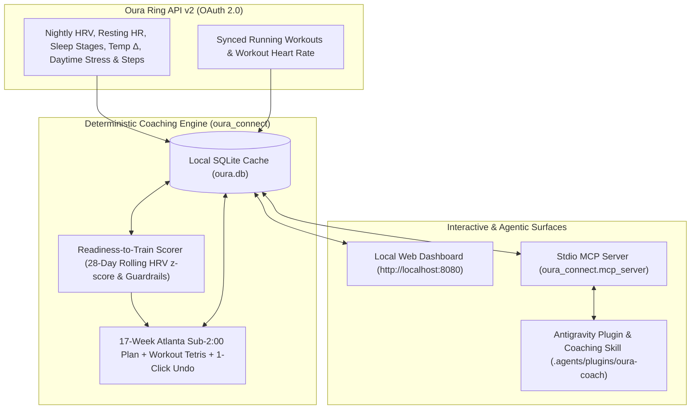

# JackieAgent — Oura-Native Adaptive Half-Marathon Coach

Zero-dependency Python `3.13` physiological endurance coach & MCP agent powered **100% natively by Oura Ring API v2**. Built to dynamically guide a **17-week Sub-2:00 Publix Atlanta Half-Marathon** build (`2026-11-09` &rarr; `2027-03-06`) by combining deterministic exercise-physiology guardrails with conversational agentic replanning.

---

## Architecture Overview



---

## Key Capabilities

- **Secure OAuth 2.0 & Rotating Refresh Tokens (`0600` Atomic Storage):** Handles Oura API v2's single-use refresh token rotation automatically with atomic file writes (`~/.config/oura-connect/`), keeping all personal tokens and health records strictly outside git.
- **Physiological Readiness-to-Train Signal (`GREEN` / `YELLOW` / `RED`):**
  - Evaluates personal **28-day rolling Nightly HRV (`z-score`)** and **Lowest Resting HR** baselines, skin temperature circuit-breakers (`>= +0.4°C` + elevated RHR), non-running step/stress load, and subjective soreness check-ins.
  - Avoids naive "one short sleep = skip run" false alarms when autonomic recovery (`HRV` & `RHR`) remains strong, while catching multi-day sympathetic fatigue.
- **17-Week Publix Atlanta Sub-2:00 Periodization + "Workout Tetris" Auto-Adapter:**
  - Progresses safely from `< 10 mpw` across 4 phases (`Aerobic & Tendon Base` &rarr; `Atlanta Hill & Threshold Build` &rarr; `Sub-2:00 Specific Peak` &rarr; `Race Taper`) with 4th-week cutbacks, rolling hill workouts, and 2x/wk 15-min calf/glute runner prehab.
  - Automatically swaps quality workouts into open flex days (`Wed` / `Fri` + weekend Long Run shift) to preserve a `>= 48h` recovery buffer—recording every change in an **Adaptation Audit Log** with **1-Click Undo**.
- **Native Antigravity Plugin (`.agents/plugins/oura-coach/`):**
  - Exposes 6 live JSON-RPC 2.0 `stdio` MCP tools (`coach_morning_briefing`, `coach_get_training_plan`, `coach_sync_telemetry`, `coach_log_checkin`, `coach_swap_or_edit_workout`, `coach_undo_adaptation`) paired with the [`half-marathon-coach`](.agents/plugins/oura-coach/skills/half-marathon-coach/SKILL.md) playbook.

---

## Quickstart

### 1. Register a Personal Oura OAuth2 Application
1. Sign in at **[https://cloud.ouraring.com](https://cloud.ouraring.com)** &rarr; **API Applications** &rarr; **Create New Application**.
2. Set **Redirect URI** to `http://localhost:8080/oauth/callback`.
3. Copy your **Client ID** and **Client Secret**.

### 2. Launch the Coach & Biometrics Web Dashboard
```bash
python3 -m oura_connect serve --open-browser
```
Open **`http://localhost:8080`**, click **Oura Settings** to paste your `Client ID` and `Client Secret`, authorize in your browser, and click **Sync Oura & Adapt**.

### 3. CLI Commands
```bash
# Morning Readiness-to-Train Coach Briefing + Active Week Schedule
python3 -m oura_connect coach

# Sync latest Oura biometrics & running workouts into local SQLite
python3 -m oura_connect sync --days 30

# Terminal table of daily Sleep, Readiness, Activity, HRV, Min HR & Stress
python3 -m oura_connect summary --days 14

# Export unified daily timeline to CSV or JSON
python3 -m oura_connect export --format csv --days 90 --output ./exports
```

---

## Automated Tests

```bash
python3 -m unittest discover -s tests -v
```
