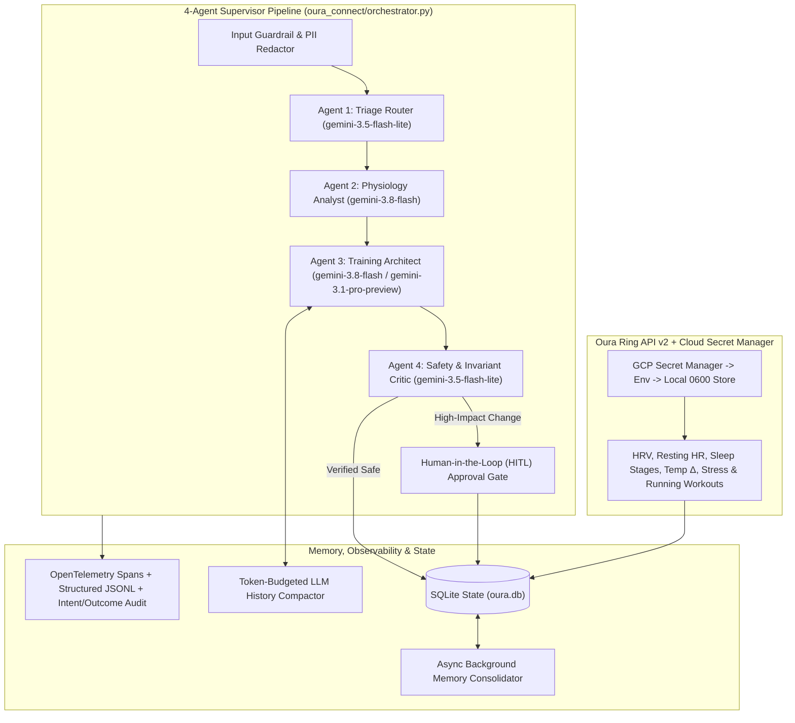

# JackieAgent — L200 Oura-Native Multi-Agent Half-Marathon Coach

Production-grade multi-agent endurance coaching system powered **100% natively by Oura Ring API v2** and the **Google Gemini 3 Interactions API** (`google-genai`). Built to dynamically guide a **17-week Sub-2:00 Publix Atlanta Half-Marathon** build (`2026-11-09` &rarr; `2027-03-06`) with deterministic physiological guardrails, Human-in-the-Loop (HITL) governance, OpenTelemetry tracing, and automated golden-dataset CI evaluation.

---

## Architecture Overview



See **[AGENTS.md](AGENTS.md)** for full sub-agent contracts, Gemini 3 model routing rules, guardrail invariants, and HITL lifecycle details.

---

## L200 Engineering Pillars

1. **Multi-Agent Orchestration, Model Routing & HITL (`oura_connect/orchestrator.py`):**
   - Coordinates `TriageRouterAgent` (`gemini-3.5-flash-lite`), `PhysiologyAnalystAgent` (`gemini-3.8-flash`), `TrainingArchitectAgent` (`gemini-3.8-flash` / `gemini-3.1-pro-preview`), and `SafetyCriticAgent`.
   - Enforces input prompt-injection & clinical red-flag guardrails (`chest pain`, `syncope`, `stress fracture`) plus output exercise-physiology invariants (`<= 15%` mileage cap, `>= 48h` quality buffer).
   - Stages high-impact plan mutations in `hitl_approvals` (`PENDING`) until explicitly approved by the athlete.
2. **Stateful Context Compaction & Async Memory (`oura_connect/memory.py`):**
   - `ConversationMemoryManager` performs token-budgeted LLM conversation history compaction into `compacted_summaries`.
   - `BackgroundMemoryConsolidator` runs asynchronous background jobs (`asyncio` + daemon `ThreadPoolExecutor`) extracting durable athlete facts into `long_term_memories`.
3. **Observability, OpenTelemetry & PII Redaction (`oura_connect/observability.py`):**
   - W3C `traceparent` distributed spans (`opentelemetry-sdk` + `traces.jsonl`), structured JSONL logging (zero raw `print` calls), explicit `IntentOutcomeTracker` drift auditing, and recursive `PIIRedactor` scrubbing emails, tokens, and API keys.
4. **Actionable MCP Tool Design (`oura_connect/mcp_server.py`, `oura_connect/errors.py`):**
   - 9 JSON-RPC 2.0 `stdio` MCP tools returning structured `ActionableToolError` payloads with `error_code`, `retryable`, `suggested_tool`, and step-by-step `recovery_instructions`.
5. **Evaluation Harness, Cloud Secret Manager, Terraform IaC & CI/CD:**
   - **Golden Evaluation Suite (`evals/`):** 16 multi-dimensional scenarios tested via `python3 -m evals.run_evals --fail-under 0.95`.
   - **Cloud Secret Manager (`oura_connect/secrets_manager.py`):** Resolves credentials via Google Cloud Secret Manager &rarr; Environment &rarr; Local `0600` files.
   - **Cloud IaC & CI (`infra/*.tf`, `Dockerfile`, `.github/workflows/ci.yml`):** Terraform Cloud Run v2 + Secret Manager + least-privilege IAM, verified automatically in GitHub Actions.

---

## Quickstart

```bash
# Launch Web Dashboard + Multi-Agent Coach Console (http://localhost:8080)
python3 -m oura_connect serve --open-browser

# Ask the 4-Agent Supervisor Orchestrator from CLI
python3 -m oura_connect ask "Can we swap Saturday's long run to Sunday?"

# Review / Approve Human-in-the-Loop (HITL) requests
python3 -m oura_connect approvals
python3 -m oura_connect approvals --approve 1

# Run Unit Tests & Golden-Dataset Agent Evaluation Harness
python3 -m unittest discover -s tests -v
python3 -m evals.run_evals --fail-under 0.95
```
